<div align="center">



<p>
  <a href="https://linkedin.com/in/jericpunay"></a>
  <a href="mailto:punay.jeric@gmail.com"></a>
  <a href="https://jericwin.github.io/Jeric-s-Portfolio/"></a>
  <a href="https://fb.com/uraharakisuke20"></a>
</p>

<p>
  
  <a href="https://github.com/Jericwin?tab=followers"></a>
  <a href="https://github.com/Jericwin?tab=repositories"></a>
</p>

</div>

---

## 💫 About Me

```yaml
name:      Jeric Punay
roles:     [Data Analyst, Software Developer, AI Enthusiast]
building:  [Data analytics projects, BI dashboards, Full-stack web apps]
learning:  [AI / Machine Learning, AWS, Azure, Docker, Kubernetes]
open_to:   [Open source, AI and data analytics collaborations]
motto:     "Data tells a story, and great software brings that story to life."
```

---

## 💻 Tech Stack

<table>
  <tr>
    <td align="right"><b>Languages</b></td>
    <td></td>
  </tr>
  <tr>
    <td align="right"><b>Frontend</b></td>
    <td></td>
  </tr>
  <tr>
    <td align="right"><b>Backend</b></td>
    <td></td>
  </tr>
  <tr>
    <td align="right"><b>Databases</b></td>
    <td></td>
  </tr>
  <tr>
    <td align="right"><b>AI / ML</b></td>
    <td></td>
  </tr>
  <tr>
    <td align="right"><b>Cloud & DevOps</b></td>
    <td></td>
  </tr>
  <tr>
    <td align="right"><b>Tools</b></td>
    <td></td>
  </tr>
</table>

---

## 📈 Contribution Activity

<div align="center">


<br/><br/>


<br/><br/>

<picture>
  <source media="(prefers-color-scheme: dark)" srcset="https://raw.githubusercontent.com/Jericwin/Jericwin/output/github-contribution-grid-snake-dark.svg">
  <source media="(prefers-color-scheme: light)" srcset="https://raw.githubusercontent.com/Jericwin/Jericwin/output/github-contribution-grid-snake.svg">
  
</picture>

</div>

---

<div align="center">

<i>"Data tells a story, and great software brings that story to life."</i>

<br/><br/>

<b>⭐ Thanks for visiting! ⭐</b>

</div>
